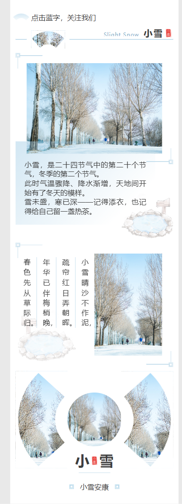
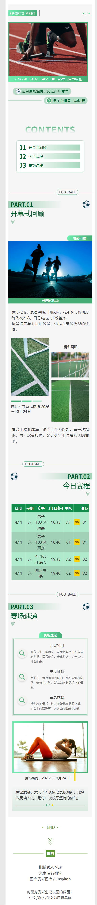

# xiumi-mcp

让 AI Agent 直接操作[秀米](https://xiumi.us)图文编辑器做公众号排版的 MCP 服务。

它用一个专属浏览器（持久化登录态）打开秀米编辑器，通过编辑器自身的 AngularJS 数据模型和官方接口完成排版工作，而不是模拟鼠标一条条拖组件。


## 能做什么

- 检索秀米模板库：分类、关键词、风格标签（体育 / 校园 / 简约 …）
- 把模板插入文章，返回组件 ID、文本槽和图片槽
- 按槽位替换模板文字（保留原设计与样式）
- 换图：本地文件或网络图片 → 自动上传秀米图床 → 写入图片槽
- 批量调整排版：字号、行距、字距、文字颜色
- 删除误插组件
- 设置文章标题与微信分享摘要
- 导出公众号可直接粘贴的最终 HTML
- 保存到秀米账号

## 环境要求

- Node.js ≥ 22.18（直接运行 TypeScript，无需编译）
- 本机安装 Edge 或 Chrome（默认用 Edge）
- 一个秀米账号（首次使用扫码或密码登录）

## 安装与运行

```bash
npm install
node src/index.ts
```

作为 MCP 客户端（stdio）配置：

```json
{
  "mcpServers": {
    "xiumi": {
      "command": "node",
      "args": ["/absolute/path/to/xiumi-mcp/src/index.ts"],
      "cwd": "/absolute/path/to/xiumi-mcp"
    }
  }
}
```

Windows 示例（注意双反斜杠）：

```json
{
  "mcpServers": {
    "xiumi": {
      "command": "C:\\Program Files\\nodejs\\node.exe",
      "args": ["C:\\path\\to\\xiumi-mcp\\src\\index.ts"],
      "cwd": "C:\\path\\to\\xiumi-mcp"
    }
  }
}
```

可选环境变量：

| 变量 | 默认值 | 说明 |
| --- | --- | --- |
| `XIUMI_PROFILE_DIR` | `%LOCALAPPDATA%\xiumi-mcp\profile` | 浏览器用户数据目录（保存登录态） |
| `XIUMI_CDP_PORT` | `9333` | 浏览器 DevTools 端口 |
| `XIUMI_CDP_URL` | `http://127.0.0.1:9333` | 连接已存在的浏览器 |
| `XIUMI_HEADLESS` | `0` | 设为 `1` 无头运行（登录/验证码不可用） |
| `XIUMI_BROWSER_PATH` | 自动探测 | 指定 Edge/Chrome 可执行文件 |

## 工具（16 个）

| 工具 | 作用 |
| --- | --- |
| `xiumi_start` | 启动浏览器并打开编辑器；`fresh: true` 新开空白图文 |
| `xiumi_status` | 登录状态、文章 ID、标题、组件数、正文预览 |
| `xiumi_login` | 打开登录页并截图，等待扫码/密码登录 |
| `xiumi_open_article` | 按文章 ID 打开已保存的图文 |
| `xiumi_list_template_tags` | 模板一级分类与子分类 ID |
| `xiumi_search_templates` | 按关键词/分类/风格标签检索模板 |
| `xiumi_insert_template` | 插入模板到文末，返回组件 ID、文本槽、图片槽 |
| `xiumi_fill_text` | 替换组件内第 N 个文本槽的文字 |
| `xiumi_set_image` | 替换第 N 个图片槽（本地文件或 URL） |
| `xiumi_delete_comp` | 删除指定组件 |
| `xiumi_set_typography` | 批量调整正文/全部文本的字号、行距、字距、颜色 |
| `xiumi_set_meta` | 设置文章标题与微信分享摘要 |
| `xiumi_get_comps` | 查看文章顶层组件与槽位数量 |
| `xiumi_get_html` | 导出公众号可用的最终 HTML（可写入文件） |
| `xiumi_save` | 保存到秀米账号 |
| `xiumi_screenshot` | 截取文章画布 PNG |

### 推荐工作流

1. `xiumi_start { fresh: true }`
2. `xiumi_login`（仅首次或登录过期）
3. `xiumi_search_templates { tagIds: [3227], query: "引导关注" }`
4. 对每个模板：`xiumi_insert_template { templateId }` → 读返回的 `compIds` / `comps`
5. `xiumi_fill_text` 填字；有图片槽时 `xiumi_set_image` 换图
6. `xiumi_set_typography` 统一字号/行距/字距
7. `xiumi_set_meta` 设标题与摘要
8. `xiumi_screenshot` 检查效果
9. `xiumi_get_html` 取最终 HTML（剪贴板里也会有一份，可直接粘进公众号编辑器）
10. 需要留档时 `xiumi_save`

## 效果示例

| 组件组合排版（小雪） | 整套商店模板（运动会） |
| --- | --- |
|  |  |

## 原理（逆向记录）

- 编辑器是 AngularJS SPA（`xiumi.us/studio/v5`）+ UEditor 内核，正文是 `tn-cell` 组件树。
- 模板列表接口：`GET https://xiumi.us/api/templates?tag_category=paper-cp&template_category=paper-cp&match_level=default&sort=DESC&limit=20&page=0&q=关键词&tag_ids=分类ID`。
- 关键词检索需要登录；未登录只能按分类浏览。
- 插入模板：调用模板面板 scope 上的 `tplLib.onTemplateClicked(event, template)`，等同于点击模板卡片。
- 填字：直接改 Angular scope 上的 `cell.text`，再 `$apply()` 同步视图，比模拟双击输入更稳。
- 换图：把图片以 multipart 传到 `POST /api/assets/image/file`（字段 `image_file`），拿到 `img.xiumi.us` 地址后写图片 cell 的 `cell.src`。
- 排版：文字 cell 的 `style` 上有 `fontSize`（百分比）、`lineHeight`、`letterSpacing`、`color`，改模型后 `$apply()`。
- 导出：点「导出 → 继续用复制粘贴」，秀米会把最终内联样式 HTML 写入剪贴板，用 `navigator.clipboard.read()` 取回。
- 保存：`onBtnClickSave()`，需要登录且受账号等级限制。
- 新开图文时可能弹「检测到未保存草稿，是否恢复」，自动化里默认点「取消」。

## 限制

- 「导入 HTML 代码」入口需要 VIP，本服务没有依赖它。
- 关键词搜索、保存、同步公众号都需要登录；部分模板/主题是会员专享。
- 字体家族（黑体/宋体）是秀米的全局「默认字体」，暂未封装；目前只支持字号、行距、字距、颜色。
- 没有「移动组件位置」的工具，只能删除后重新插入来调整顺序。
- 秀米前端改版可能影响选择器，遇到问题先跑 `xiumi_status` 确认编辑器结构。
- 商店整篇模板的「另存给自己」目前在 UI 中完成，尚未封装成工具。

## 故障排查

- **浏览器启动超时**：关闭残留的 xiumi-mcp 浏览器窗口（任务管理器里带 `xiumi-mcp` 用户目录的 `msedge.exe`）后重试。
- **导出返回空 HTML**：确保浏览器窗口在前台；`xiumi_get_html` 依赖剪贴板读取权限。
- **保存提示「登录以后才可以保存图文」**：先 `xiumi_login`。
- **在受限沙箱里运行**：Chromium 依赖命名管道启动子进程，沙箱可能直接拒绝；请以普通权限运行本服务。

## 目录结构

```
src/
  index.ts      # MCP 服务、工具定义
  xiumi.ts      # 秀米页面操作（模板、填字、换图、排版、导出、保存、删除）
  browser.ts    # 浏览器启动、CDP 连接、登录态复用
  config.ts     # 路径、端口、环境变量
integrations/dsh/  # DeepSeek Harness 配置型 bundle（可选）
docs/              # 截图
```

## 免责声明

本项目通过浏览器自动化操作用户自己的秀米账号，仅用于个人排版效率工具。请在遵守秀米服务条款的前提下使用；因使用本工具产生的账号风险、内容版权或平台规则问题由使用者自行承担。

## License

[MIT](LICENSE)
